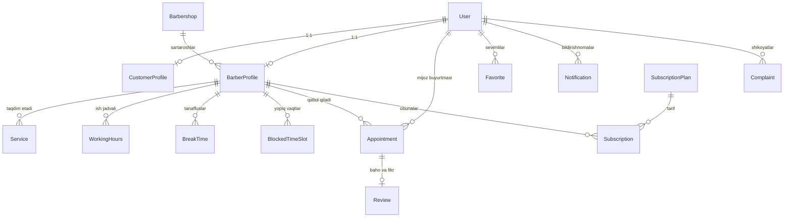

# Barber Booking — Arxitektura Hujjati

Ushbu loyiha zamonaviy sartaroshxona va ustalar uchun mijozlarni ro'yxatga olish, bo'sh vaqtlarni boshqarish, daromad statistikasi va ma'muriy nazorat tizimini taqdim etuvchi ko'p rolli (Mijoz, Sartarosh, Administrator) to'liq avtomatlashtirilgan mobil va web platformadir.

---

## 1. Tizim Rollari va Imkoniyatlari

| Rol | Interfeys | Asosiy Vazifalar |
|---|---|---|
| **Mijoz (Customer)** | Flutter Android Ilovasi | Sartaroshlarni qidirish, narxlar va xizmatlarni ko'rish, bo'sh vaqtlarga yozilish, navbatni bekor qilish/ko'chirish, sevimli ustalarni saqlash, sharh va baho qoldirish. |
| **Sartarosh (Barber)** | Flutter Android Ilovasi | Qabul so'rovlarini qabul qilish/rad etish, ish kunlari va tanaffuslarni sozlash, xizmatlar narxi va davomiyligini boshqarish, kunlik/oylik daromad grafiklari, mijozlar bazasi. |
| **Administrator (Admin)** | Responsive Django Web Dashboard & REST API | Yangi sartaroshlarni tekshirish va tasdiqlash (KYC), mijozlar va ustalar hisoblarini boshqarish, shikoyatlarni moderatsiya qilish, monitoring, obuna tariflari, audit jurnali. |

---

## 2. Texnologik Stek

```
[ Flutter Android Mobile App ]
      │ (REST API via Dio + JWT Tokens)
      ▼
[ Django REST Framework Backend ]
      │
      ├──> [ PostgreSQL / SQLite Database ]
      ├──> [ Responsive Admin Web Dashboard ]
      ├──> [ OpenAPI / Swagger Documentation ]
      └──> [ Firebase Cloud Messaging (FCM) Service ]
```

- **Mobil Dastur:** Flutter 3.41, Dart 3.11
- **State Management:** Riverpod 2.6
- **Routing & Navigatsiya:** GoRouter 14.8
- **Tarmoq va API:** Dio 5.11 (avtomatik JWT header inyektsiyasi va 401 refresh token interceptor bilan)
- **Mahalliy Xavfsiz Xotira:** Flutter Secure Storage (Keychain / Android Keystore)
- **Grafiklar:** fl_chart 0.68
- **Backend:** Python 3.13, Django 5.2, Django REST Framework 3.18
- **Autentifikatsiya:** SimpleJWT (Access + Refresh tokenlar)
- **Ma'lumotlar bazasi:** PostgreSQL (Ishlab chiqish uchun SQLite fallback bilan)
- **API Hujjatlashtirish:** drf-spectacular (OpenAPI 3.0 / Swagger UI)

---

## 3. Ma'lumotlar Bazasi Modellar Diagrammasi (ERD)



---

## 4. Ikki Tomonlama Band Qilishni Oldini Olish (Double-Booking Prevention)

Parallel buyurtmalarni oldini olish uchun backendda tranzaksiya darajasida blokirovka (`select_for_update()`) qo'llanilgan:

```python
with transaction.atomic():
    conflict = Appointment.objects.select_for_update().filter(
        barber=barber,
        appointment_date=appt_date,
        status__in=[Appointment.Status.PENDING, Appointment.Status.CONFIRMED],
        start_time__lt=end_time,
        end_time__gt=start_time
    ).exists()

    if conflict:
        raise serializers.ValidationError("Tanlangan vaqt band qilingan!")
```

Shuningdek, xizmat narxi va davomiyligi qabul yaratilgan vaqtda tarixiy ravishda `Appointment` yozuviga nusxalanadi, shuning uchun sartarosh kelajakda narxni o'zgartirsa ham, o'tgan buyurtmalar statistikasi buzilmaydi.
